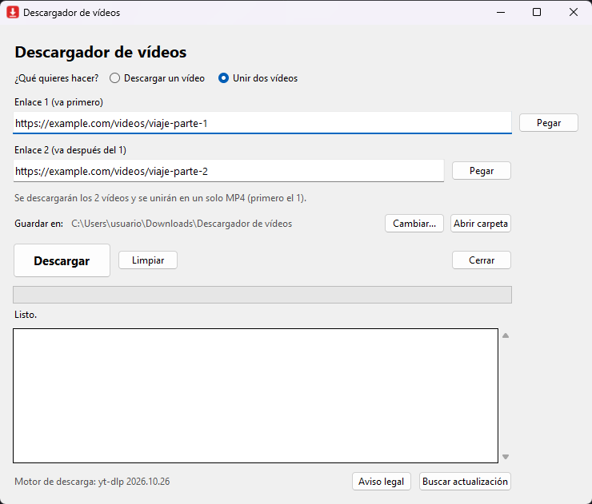
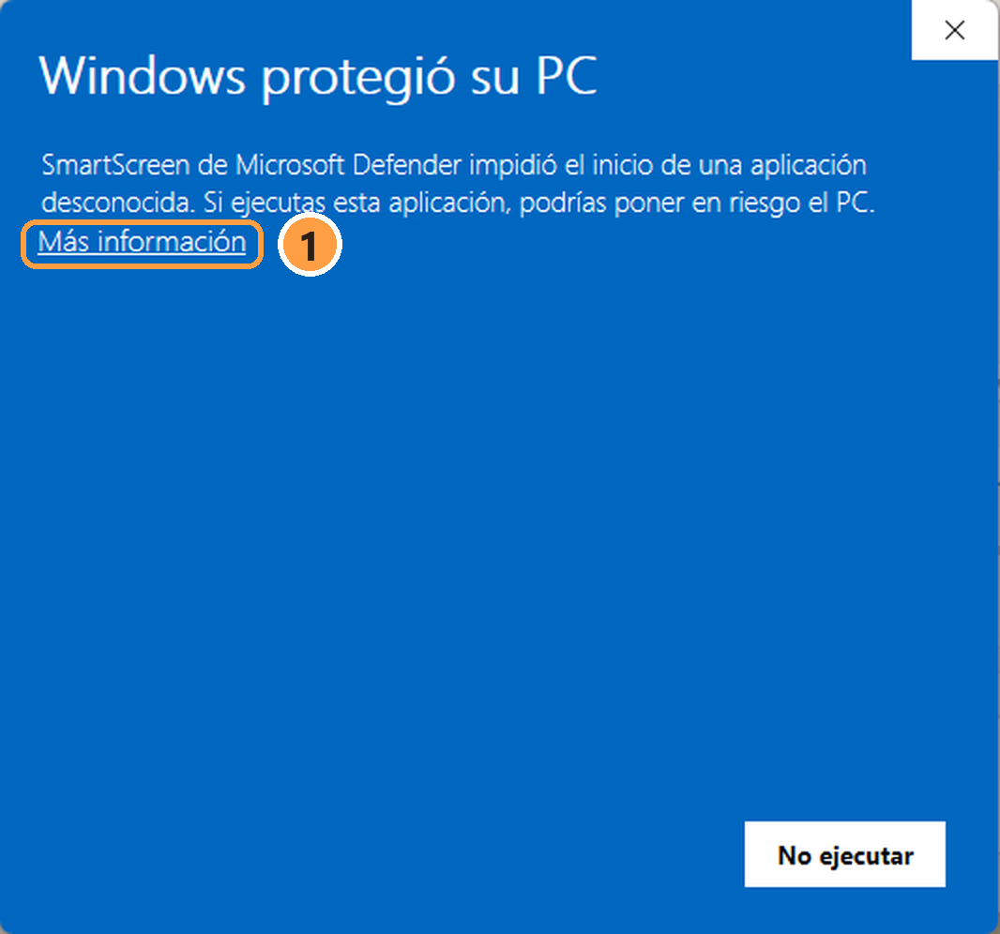
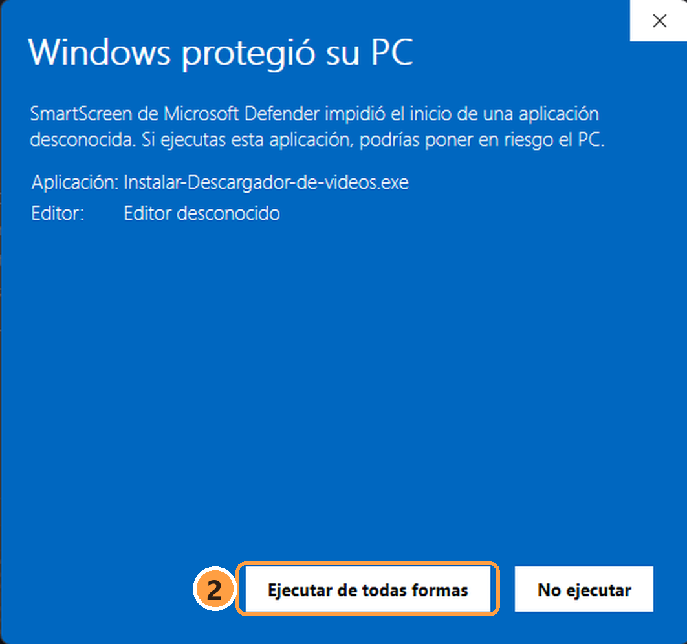

# Descargador de vídeos

Programa para Windows con interfaz sencilla:

- **Un enlace** → descarga el vídeo en MP4 (H.264 + AAC, hasta 1080p).
- **Dos enlaces** → descarga ambos y los une en un único MP4: primero el del enlace 1 y después el del 2.

Al terminar avisa con una ventana para reproducir el vídeo o abrir la carpeta.



## Descargar

**[⬇ Descargar el instalador para Windows](https://github.com/Oriol-1/descargador-de-videos/releases/latest/download/Instalar-Descargador-de-videos.exe)**
· [Versión portable (.zip)](https://github.com/Oriol-1/descargador-de-videos/releases/latest/download/Descargador-de-videos-portable.zip)
· [Página web](https://oriol-1.github.io/descargador-de-videos/)

### ⚠️ Importante al instalar: la pantalla azul de Windows es normal

Windows mostrará **«Windows protegió su PC»** porque el programa no tiene la firma digital de Microsoft, que es una **licencia de pago**. No significa que tenga virus (el código está aquí, a la vista). Para instalarlo:

1. Pulsa **Más información**
2. Pulsa **Ejecutar de todas formas**

| 1. Pulsa «Más información» | 2. Pulsa «Ejecutar de todas formas» |
|---|---|
|  |  |

### Compartir

- Enlace de descarga directa: **https://oriol-1.github.io/descargador-de-videos/descargar**
- Página web: **https://oriol-1.github.io/descargador-de-videos**


## Para desarrolladores

Requisitos: Python 3.12+, y para compilar, [Inno Setup 6](https://jrsoftware.org/isinfo.php).

```bash
python -m pip install --upgrade "yt-dlp[default]" imageio-ffmpeg pyinstaller pillow
python descargador_gui.py          # ejecutar desde el código
```

| Archivo | Para qué sirve |
|---|---|
| `descargador_gui.py` | El programa (interfaz + descarga + unión con ffmpeg) |
| `Descargador de videos.bat` | Abre el programa desde el código con doble clic |
| `empaquetado/construir.py` | Genera el `.exe`, la versión portable y el instalador |
| `empaquetado/instalador.iss` | Script de Inno Setup del instalador |
| `empaquetado/publicar.py` | Publica una versión nueva en GitHub Releases |
| `docs/` | Página web (GitHub Pages) |
| `descargar.py` | Versión antigua de consola |

### Publicar una versión nueva

1. Opcional: deja `deno.exe` ([descarga oficial](https://github.com/denoland/deno/releases)) en `empaquetado/bin/` para incluirlo; así el programa funciona en PCs sin Node ni Deno.
2. Sube `VERSION` en `empaquetado/construir.py`.
3. `python empaquetado/construir.py`
4. `python empaquetado/publicar.py` (necesita [GitHub CLI](https://cli.github.com) con sesión iniciada).

La web y el README enlazan a `releases/latest`, así que siempre ofrecen la última versión.

## Uso responsable

Este programa es una **herramienta técnica**. Quien lo usa es el **único responsable** de respetar los derechos de autor y las condiciones de cada web.

- ✅ **Puedes usarlo con:** tus propios vídeos, contenido de dominio público o con licencia que permita descargarlo (p. ej. Creative Commons) y contenido para el que tengas permiso del titular.
- ❌ **No lo uses para:** descargar contenido protegido sin permiso, eludir medidas técnicas de protección o restricciones de acceso, ni redistribuir o explotar contenido ajeno.

Al instalar y al abrir el programa por primera vez hay que **aceptar los [términos de uso](TERMINOS.txt)**.

## Aviso legal

- **Proyecto personal y educativo, sin ánimo de lucro:** gratuito, sin anuncios, sin donaciones y sin recogida de datos.
- **Independiente:** no está afiliado, patrocinado ni respaldado por ninguna plataforma de vídeo. Las marcas citadas pertenecen a sus titulares.
- El autor **no aloja ni distribuye ningún vídeo**: las descargas se realizan directamente entre el equipo de la persona usuaria y la web que ella elige.
- Si crees que algo de este repositorio vulnera tus derechos, [abre una incidencia](https://github.com/Oriol-1/descargador-de-videos/issues/new) y se revisará y, si procede, se retirará de inmediato.

Texto completo: [aviso legal, términos, privacidad y licencias](https://oriol-1.github.io/descargador-de-videos/legal/).

## Licencia

El código de este proyecto se publica bajo la [licencia MIT](LICENSE): se ofrece **«tal cual», sin garantías** de ningún tipo. Los componentes incluidos en el programa tienen sus propias licencias ([LICENCIAS-TERCEROS.txt](LICENCIAS-TERCEROS.txt)):

[yt-dlp](https://github.com/yt-dlp/yt-dlp) (Unlicense) · [FFmpeg](https://ffmpeg.org) (GPL v3) · [Deno](https://deno.com) (MIT) · Python (PSF) · Tcl/Tk · PyInstaller (GPL con excepción) · fuentes de la web (SIL OFL 1.1)
